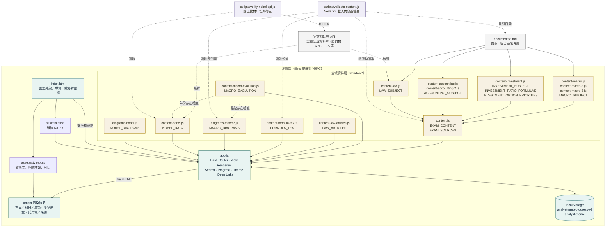
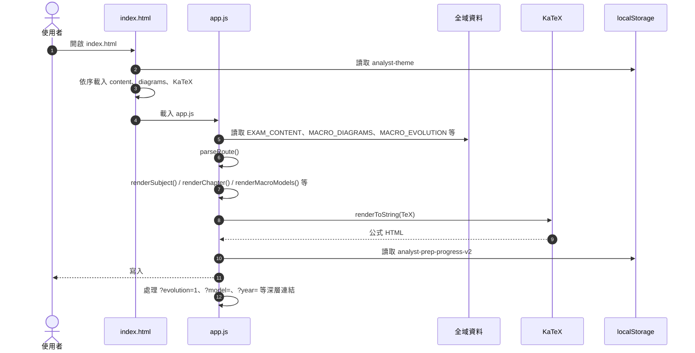
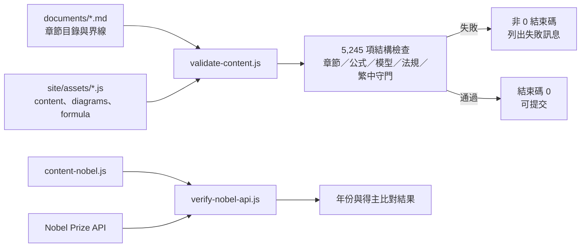
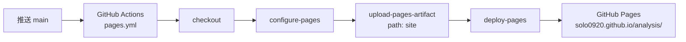

# 分析師備考站 — 系統架構

更新：2026-10-21

本專案是**純靜態、無建置流程**的單頁網站。`site/index.html` 只提供固定外殼，所有頁面由 `site/assets/app.js` 依 hash route 渲染到 `#main`。內容以 `window.*` 全域物件在瀏覽器載入，沒有後端、資料庫或執行時 API 請求。

## 1. 系統概覽

## 2. 載入順序

`index.html` 的腳本順序是資料契約的一部分：先建立各科目與公式資料，再由 `content.js` 聚合；圖表與諾貝爾資料最後載入，`app.js` 才能讀到完整的 `window.*`。

```mermaid
flowchart LR
  HTML["index.html"] --> Macro["content-macro.js<br/>content-macro-2.js<br/>content-macro-3.js"]
  Macro --> Evolution["content-macro-evolution.js"]
  Evolution --> Investment["content-investment.js"]
  Investment --> Accounting["content-accounting.js<br/>content-accounting-2.js"]
  Accounting --> Law["content-law.js"]
  Law --> LawArticles["content-law-articles.js"]
  LawArticles --> Formula["content-formula-tex.js"]
  Formula --> Content["content.js<br/>聚合四個科目"]
  Content --> MacroDiagrams["diagrams-macro*.js"]
  MacroDiagrams --> Nobel["content-nobel.js"]
  Nobel --> NobelDiagrams["diagrams-nobel.js"]
  NobelDiagrams --> Katex["katex.min.js"]
  Katex --> App["app.js"]
```

> `content-macro-2.js`、`content-macro-3.js` 依賴 `MACRO_SUBJECT`；`content-accounting-2.js` 依賴 `ACCOUNTING_SUBJECT`；`content.js` 依賴四個科目都已存在。這個順序不可任意調換。

## 3. 執行時請求流程

## 4. 路由與視圖

| Hash route | 渲染函式 | 主要資料來源 |
| --- | --- | --- |
| `#/` | `renderHome()` | `EXAM_CONTENT` |
| `#/subject/:id` | `renderSubject()` | 科目內容、模型圖、學派演進圖、投資學公式 |
| `#/chapter/:id` | `renderChapter()` | 章節內容、KaTeX、法規全文、模型圖 |
| `#/models/macro` | `renderMacroModels()` | `MACRO_DIAGRAMS`、`NOBEL_DATA`、`NOBEL_DIAGRAMS` |
| `#/nobel` | `renderNobelPage()` | `NOBEL_DATA`、`NOBEL_DIAGRAMS` |
| `#/sources` | `renderSources()` | `EXAM_CONTENT.sources` |
| `#/about` | `renderAbout()` | 靜態說明與 `localStorage` 進度 |

深層連結由 `render()` 在寫入 `#main` 後處理：

- `#/subject/macro?evolution=1` → `#macro-evolution`
- `#/models/macro?model=model-macro-06-0` → 指定 `.models-entry`，短暫加上 `.is-targeted`
- `#/models/macro?chapter=nobel` → `#models-nobel`
- `#/nobel?year=YYYY` → `#nobel-YYYY`
- `#/nobel?group=nobel-XX` → `#nobel-group-nobel-XX`
- `#/nobel?table=1` → `#nobel-table`
- `#/nobel?models=1` → `#nobel-models`
- `#/chapter/:id?section=N` → `#section-N`

## 5. 資料契約與單一來源

| 全域物件 | 定義檔案 | 用途 |
| --- | --- | --- |
| `window.EXAM_CONTENT` | `content.js` | 四科目聚合、首頁文案、來源清單、學習流程 |
| `window.MACRO_SUBJECT` | `content-macro*.js` | 總體經濟學 13 章與 50 個學習單元 |
| `window.INVESTMENT_SUBJECT` | `content-investment.js` | 投資學 16 章與 48 個學習重點 |
| `window.ACCOUNTING_SUBJECT` | `content-accounting*.js` | 會計學 23 章與 64 個單元 |
| `window.LAW_SUBJECT` | `content-law.js` | 證券法規 21 章、21 節 |
| `window.LAW_ARTICLES` | `content-law-articles.js` | 15 部官方 1,507 條法規全文與外部法令摘要 |
| `window.FORMULA_TEX` | `content-formula-tex.js` | 以「章節 ID::節名」綁定的 KaTeX 公式 |
| `window.INVESTMENT_RATIO_FORMULAS` | `content-investment.js` | 投資學 32 條比例分析公式的單一來源 |
| `window.INVESTMENT_OPTION_PRIORITIES` | `content-investment.js` | 5 項選擇權評價優先順序與 13 條公式 |
| `window.MACRO_DIAGRAMS` | `diagrams-macro*.js` | 21 張總體章節模型圖，鍵為 `chapterId#sectionIndex` |
| `window.MACRO_EVOLUTION` | `content-macro-evolution.js` | 6 階段、10 節點、模型錨點與諾貝爾年份 |
| `window.NOBEL_DATA` | `content-nobel.js` | 58 屆諾貝爾年表、17 個圖組 |
| `window.NOBEL_DIAGRAMS` | `diagrams-nobel.js` | 17 組諾貝爾模型 SVG |

單一來源規則：

- 章節頁與模型總覽都讀同一份 `MACRO_DIAGRAMS`；模型總覽不複製內容。
- 學派演進圖不複製模型名稱或諾貝爾得主，而是用錨點與年份反查 `MACRO_DIAGRAMS`、`NOBEL_DATA`。
- 諾貝爾年表頁與模型總覽的諾貝爾區都讀同一份 `NOBEL_DATA`、`NOBEL_DIAGRAMS`。
- 投資學比例公式與選擇權公式各自只有一份資料，章節頁與科目頁共用。
- 驗證腳本以 Node `vm` 載入同一批 `site/assets/*.js`，不維護第二套內容模型。

## 6. 驗證與開發工具

- `validate-content.js`：離線執行，檢查章節界線、來源引用、公式綁定、模型圖、學派演進圖、法規全文與繁體中文守門。
- `verify-nobel-api.js`：需要網路，只比對諾貝爾年表的年份與得主，不檢查公式或模型圖。
- 這兩個腳本只在開發／驗證時執行，不會被 `index.html` 載入，也不會增加瀏覽器執行時負擔。

## 7. GitHub Pages 部署

- `site/` 是唯一的發佈目錄；`documents/`、`specs/`、`.specify/` 與驗證腳本不會進入 Pages artifact。
- `site/.nojekyll` 停用 Jekyll 處理；workflow 以 `include-hidden-files: true` 將它納入 artifact。
- `site/404.html` 將未知路徑導回站點根目錄。
- 所有 CSS、JavaScript、SVG 與 KaTeX 字型都使用相對路徑，因此可在 `/analysis/` 子路徑下運作。
- 推送 `main` 或手動執行 workflow 都會重新部署；`site/**` 與 workflow 檔變更才會觸發自動部署。

## 8. 倉庫目錄分層

| 目錄 | 角色 | 瀏覽器執行時載入 |
| --- | --- | --- |
| `site/` | 靜態網站、內容模組、圖表、樣式與驗證腳本 | 是（`site/scripts/` 除外） |
| `documents/` | 來源目錄、校對紀錄、官方核對與架構文件 | 否 |
| `specs/` | 功能規格與需求文件 | 否 |
| `.specify/` | Spec Kit 工作流程、範本與整合設定 | 否 |
| `research/` | 研究資料與摘要 | 否 |

## 9. 設計限制

- 無建置步驟、無框架、無後端；`file://` 可直接開啟。
- 所有內容與 SVG 都內嵌在 JavaScript，執行時不 `fetch` 本地資料。
- 只有外部來源連結與 `verify-nobel-api.js` 需要網路。
- 進度與主題存在 `localStorage`；清除瀏覽器資料即重置。
- 模型圖是概念示意，不提供互動拖曳或數值模擬。
- 官方公告與正式教材仍是最終依據；網站驗證通過不代表官方認證。
